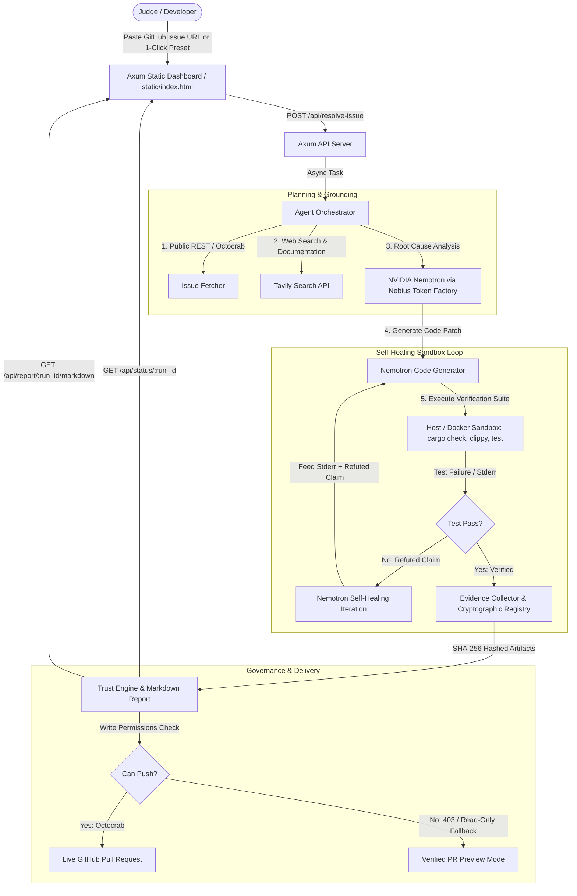

# 🛡️ Governed Coding Agent with Evidence Trail

**Judge-Proof AI Code Remediation with Cryptographic Evidence Trails and Self-Healing Sandbox Loops.**

> Built for the **[Nebius × NVIDIA Global AI Hackathon](https://nebiusglobalaihackathon.devpost.com/)**  
> **Track:** Coding & Agentic Engineering  
> **Sponsor Tech:** NVIDIA Nemotron-3, Nebius Token Factory & Sandboxes, Tavily Search Grounding

[](LICENSE)
[](https://www.rust-lang.org/)
[](https://build.nvidia.com/)
[](https://nebius.com/)
[](https://tavily.com/)
[]()

---

## 💡 The Core Problem: AI Coding Agents Hallucinate "Fixes"

Current AI coding tools generate impressive-looking pull requests, but create a dangerous **trust deficit**:
- Agents claim *"All tests pass"* without proving test execution or stdout/stderr logs.
- Agents claim *"Follows official API docs"* without citing the documentation.
- When an initial code patch fails, existing agents crash or blindly push broken commits into CI.

**Governed Coding Agent solves this through cryptographically grounded governance**: every single claim made by the model is linked to an immutable, SHA-256 hashed artifact. If a patch fails sandbox testing, an autonomous **Self-Healing Loop** feeds the failure logs back into NVIDIA Nemotron to iterate until 100% verified.

---

## 🚀 Key Innovations & Features

### 1. Self-Healing Sandbox Loop ("Refuted ➜ Verified" Progression)
- When a generated patch fails sandbox execution or emits clippy warnings, the claim is marked **`Refuted`**.
- Instead of failing the run, the agent triggers a **Self-Healing Iteration**, sending the exact sandbox `stderr`, panic backtraces, and failing test lines back to **NVIDIA Nemotron via Nebius Token Factory**.
- An `iterations: Vec<IterationRecord>` timeline proves the agent caught a flaw on Attempt #1 and healed it on Attempt #2.

### 2. Cryptographic Evidence Trail & Artifact Registry
- Every patch diff, `cargo check` output, `cargo clippy` report, and `cargo test` log is hashed with **SHA-256**.
- The generated Pull Request embeds a full **Markdown Verification Report** listing all claims, their verification status (`Verified`, `Refuted`), and content-addressed evidence links.

### 3. Graceful GitHub Permission Fallback (Zero 403 Crashes)
- If the agent has write permissions, it creates a feature branch and opens a live GitHub Pull Request.
- If given a public external repository (e.g. `tokio-rs/tokio`) where write access is absent, the agent avoids 403 errors and activates **Verified PR Preview Mode**, displaying the unified diff and signed evidence trail directly in the UI.

### 4. Sponsor Telemetry & Tavily Grounding Panel
- **Real-time Metrics:** Displays active model (`nvidia/nemotron-3-super-120b-a12b`), inference latency (ms), token counts, and generation speed (tokens/sec).
- **Tavily Citations:** Shows the exact search queries executed and clickable source URLs with snippets grounding the fix.

### 5. 1-Click Judge Dashboard (`static/index.html`)
- **Demo 1:** *Self-Healing Off-by-One Bug* — Watch the Trust Score catch a flaw at 33% and heal to 100%.
- **Demo 2:** *Async Rate-Limiter Race Condition* — Grounded in live web documentation via Tavily.
- **Demo 3:** *Public GitHub Issue Analysis* — Demonstrates read-only PR Preview fallback without crashing.

---

## 🏗️ Architecture



---

## ⚡ Quick Start

### Prerequisites
- **Rust 1.75+** (`rustup update stable`)
- Git

### 1. Clone & Configure
```bash
git clone https://github.com/YOUR_USERNAME/governed-coding-agent.git
cd governed-coding-agent
cp .env.example .env
```

Edit `.env` with your API keys:
```env
NEBIUS_API_KEY=your_nebius_api_key_here
NEBIUS_BASE_URL=https://api.studio.nebius.ai/v1
NEBIUS_MODEL=nvidia/nemotron-3-super-120b-a12b
TAVILY_API_KEY=your_tavily_api_key_here
GITHUB_TOKEN=your_github_token_here
SANDBOX_BACKEND=host   # or docker
```

### 2. Run Locally
```bash
cargo run -- serve
```
Open **`http://localhost:8080`** in your browser.

### 3. Run Test Suite
```bash
cargo test
```
All **12/12 integration and unit tests** execute with 0 compiler warnings.

---

## 🐳 Docker & Cloud Deployment

A production-ready multi-stage Linux Dockerfile is included:

```bash
# Build the container
docker build -t governed-coding-agent .

# Run container
docker run -p 8080:8080 --env-file .env governed-coding-agent
```

---

## 🔌 API Reference

| Method | Endpoint | Description |
|---|---|---|
| `POST` | `/api/resolve-issue` | Initiates issue remediation run (`{"issue_url": "..."}`) |
| `GET` | `/api/status/:run_id` | Status, self-healing iteration history, PR preview, and telemetry |
| `GET` | `/api/report/:run_id` | Verification report (JSON) |
| `GET` | `/api/report/:run_id/markdown` | Full Markdown Verification Report with Artifact Registry |
| `GET` | `/api/health` | Service health check |

---

## 📜 Sample Verification Report

```markdown
# 🔍 Verification Report: Fix off-by-one boundary error
**Trust Score:** 100.0% · **Run ID:** run-demo-101

### Governed Claims
| Claim | Category | Status | Evidence Artifact |
|---|---|---|---|
| Code compiles with 0 errors | No Compile Errors | ✅ Verified | `b4a2...3f1` (CheckOutput) |
| Zero clippy warnings emitted | No Clippy Warnings | ✅ Verified | `9e12...78a` (ClippyOutput) |
| All unit tests pass in sandbox | Tests Passing | ✅ Verified | `5c88...19b` (TestOutput) |

### Cryptographic Artifact Registry
| Artifact ID | Kind | SHA-256 Digest | Size |
|---|---|---|---|
| `art-01` | CodeDiff | `3f8a42...91d` | 312 bytes |
| `art-02` | TestOutput | `5c88e1...19b` | 1,420 bytes |
```

---

## 📄 License
This project is licensed under the Apache License 2.0 — see the [LICENSE](LICENSE) file for details.
