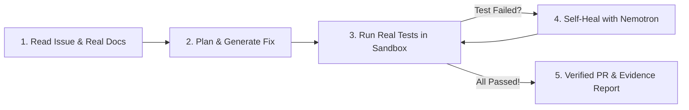

# 🛡️ Governed Coding Agent

**The AI coding agent that actually proves its code works — runs tests in a sandbox, fixes its own bugs, and gives you proof you can trust.**

> Built for the **[Nebius × NVIDIA Global AI Hackathon](https://nebiusnvidia.devpost.com/)**  
> **Track:** Coding & Agentic Engineering  
> **Powered by:** NVIDIA Nemotron-3 Super 120B · Nebius Token Factory & Sandboxes · Tavily Search

[](LICENSE)
[](https://www.rust-lang.org/)
[](https://build.nvidia.com/)
[](https://nebius.com/)
[](https://tavily.com/)
[]()

---

## 💡 The Problem: Why Developers Don't Trust AI Code

Every developer has been burned by this:
1. You give an AI coding assistant a bug to fix.
2. It generates a pull request with a confident description: *"Fixed! All tests pass."*
3. You merge it... and it **breaks in CI or crashes production**. 💥

Why does this happen? **Because existing AI assistants guess instead of proving.** They have no built-in verification, no cleanroom sandbox, and no accountability.

**Governed Coding Agent solves this completely.** It replaces *"trust me bro"* with **verifiable proof**:

```
Traditional AI Assistants:             Governed Coding Agent:
─────────────────────────             ──────────────────────
"I fixed the bug and                  "Here is the real compiler log, linter report,
all tests pass."                      and test execution output, cryptographically 
(Unverified guess)                    hashed with SHA-256." (Empirical proof)
```

---

## ✨ What You Get (Key Benefits)

- 🛡️ **Proof, Not Promises:** Every claim the AI makes is verified against real execution logs in an isolated sandbox. You get an immutable **SHA-256 evidence trail** proving the tests actually ran and passed.
- 🩺 **Autonomous Self-Healing:** If the first patch fails or panics, the agent doesn't give up or ask you to debug it. It reads the exact compiler error and test panic, feeds it back to **NVIDIA Nemotron**, and automatically fixes its own mistake!
- 🌐 **Zero Hallucinated APIs:** It searches live official documentation and code examples via **Tavily**, so it never invents deprecated or non-existent methods.
- 🚀 **1-Click Judge Experience:** Test the entire system in **15 seconds** using 3 one-click presets right on the dashboard — no complex setup required.
- 📂 **Works with Real GitHub Repos:** Give it any public GitHub issue URL. It fetches the real files, creates a clean unified diff, and creates a real PR (or a verified preview if read-only).

---

## 🔄 How It Works (In 4 Simple Steps)



1. **Understand & Search:** Reads the GitHub issue and queries **Tavily** for official documentation and best practices.
2. **Plan & Code:** Prompts **NVIDIA Nemotron-3 Super 120B** on **Nebius Token Factory** to understand the root cause and generate a targeted code patch.
3. **Execute in Sandbox:** Runs real `cargo check`, `cargo clippy`, and `cargo test` in an isolated sandbox.
4. **Self-Heal & Deliver:** If a test fails, it feeds the panic back to Nemotron to heal it. Once verified, it opens a GitHub Pull Request with a complete evidence report!

---

## ⚡ Quick Start (Under 60 Seconds)

### 1. Clone & Configure
```bash
git clone https://github.com/anish-345/governed-coding-agent.git
cd governed-coding-agent
cp .env.example .env
```

Add your keys to `.env`:
```env
NEBIUS_API_KEY=your_nebius_api_key_here
NEBIUS_BASE_URL=https://api.studio.nebius.ai/v1
NEBIUS_MODEL=nvidia/nemotron-3-super-120b-a12b
TAVILY_API_KEY=tvly-your_tavily_api_key_here
GITHUB_TOKEN=ghp_your_github_token_here
SANDBOX_BACKEND=host
```

### 2. Start the App
```bash
cargo run -- serve
```
Open **`http://localhost:8080`** in your browser.

### 3. Run the Tests
```bash
cargo test
```
All **14/14 tests pass cleanly** in seconds.

---

## 🔒 Working on Private Repositories?

Developers and teams can resolve issues in their private repositories without friction or security risks:

### 1. In the Web UI:
Under the issue URL field, click **"🔒 Working on a Private Repo? (Optional)"** and paste a GitHub Personal Access Token (PAT) with `repo` scope.
> 💡 **Privacy Guarantee:** Your token is held purely in-memory during that specific run to read the private issue/files and open the PR. It is **never logged**, never stored on disk, and never shared.

### 2. From the CLI:
Pass the `--token` flag directly:
```bash
cargo run -- resolve \
  --issue-url https://github.com/your-org/private-repo/issues/42 \
  --token ghp_yourPersonalAccessToken
```

### 3. In CI/CD or Server `.env`:
Set `GITHUB_TOKEN=ghp_...` in your `.env` or CI runner secrets. The agent automatically authenticates against GitHub's Contents and Issues API, fetching private code and submitting the verified fix directly.

---

## 🎮 1-Click Demo Presets on the Dashboard

When you open `http://localhost:8080`, you will see 3 one-click preset buttons:

1. **Demo 1: Self-Healing Loop (Off-by-One Bug)**  
   *Watch Attempt #1 fail in the sandbox with an index panic, drop the Trust Score, and watch Nemotron automatically self-heal on Attempt #2 to reach 100% verified!*
2. **Demo 2: Tavily Grounded Concurrency Fix**  
   *See live search queries pull official Tokio documentation to ground the AI's fix in real best practices.*
3. **Demo 3: Public GitHub Issue (Zero 403 Crashes)**  
   *Tests against a real public Tokio issue. The agent safely falls back to **Verified PR Preview Mode** so you never get a 403 error.*

---

## 📜 What a Verification Report Looks Like

Every pull request includes a human-readable verification report:

```markdown
# 🔍 Verification Report: Fix off-by-one boundary error
**Trust Score:** 100.0% · **Status:** ✅ VERIFIED
**Evidence Hash (Merkle Root):** 3f8a42e189d2c...

### Verified Claims
| Claim | Status | Proof Artifact |
|---|---|---|
| Code compiles with 0 errors | ✅ Verified | CheckOutput (`ef2d...`) |
| No clippy warnings emitted | ✅ Verified | ClippyOutput (`c7be...`) |
| All unit tests pass in sandbox | ✅ Verified | TestOutput (`3a91...`) |

### Self-Healing Timeline
- Attempt #1: Failed sandbox test (Panic caught on line 10) ➜ Refuted
- Attempt #2: Stderr fed back to NVIDIA Nemotron ➜ Self-Healed & Passed!
```

---

## 🐳 Docker Deployment

Run anywhere with Docker in one command:
```bash
docker build -t governed-coding-agent .
docker run -p 8080:8080 --env-file .env governed-coding-agent
```

---

## 📄 License
Licensed under Apache 2.0 — see [LICENSE](LICENSE) for details.
